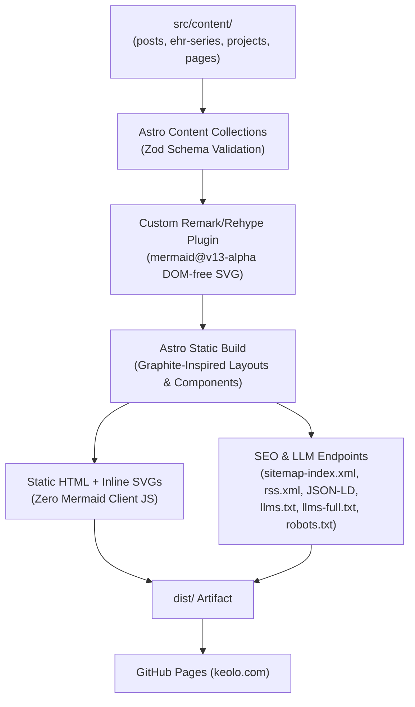

# Technical Design: Convert keolo.com from Hugo to Astro

## Architecture Overview

The site transitions from a Docker-wrapped Hugo + PaperMod static generator with client-side Mermaid v10 rendering to a native **Astro** (latest v5+) static site powered by **Node.js 22+**, **pnpm**, **Tailwind CSS** (v4), and **TypeScript**. All 19 Mermaid diagrams are compiled at build/dev time using **Mermaid v13 Alpha** (`mermaid@v13-alpha`) via a custom Remark/Rehype plugin, eliminating client-side Mermaid JS entirely.



---

## Project Directory Structure

```text
.
├── .github/workflows/deploy.yml    # Node 22 + pnpm + Astro build -> GitHub Pages
├── Makefile                        # run (alv run), maintain (alv maintain), build, clean
├── astro.config.mjs                # Site URL, Tailwind v4, Sitemap, Mermaid v13 plugin
├── package.json                    # Astro, Tailwind, mermaid@v13-alpha, ESLint, Prettier
├── pnpm-lock.yaml
├── tsconfig.json
├── public/
│   ├── CNAME                       # keolo.com
│   ├── robots.txt                  # Allows search & AI crawlers; points to sitemap-index.xml
│   ├── favicon.ico
│   ├── k-mark.svg
│   └── assets/                     # favicon-16x16.png, favicon-32x32.png, apple-touch-icon.png
└── src/
    ├── assets/                     # Optimized images (covers, project screenshots, EHR diagrams)
    ├── components/
    │   ├── Header.astro            # Graphite-style nav + Google Calendar "Book a Call" CTA
    │   ├── Footer.astro            # Links, social icons, copyright
    │   ├── SEOHead.astro           # Canonical, OG, Twitter Cards, JSON-LD
    │   ├── Carousel.astro          # Interactive image carousel replacing raw HTML in projects
    │   ├── SeriesNav.astro         # Multi-part chapter navigation for EHR tutorial series
    │   └── MotionReveal.astro      # Lightweight scroll-reveal / Graphite interaction primitives
    ├── content/
    │   ├── config.ts               # Zod schemas for posts, projects, pages (draft filtering)
    │   ├── posts/                  # Standalone posts + how-to-build-an-ehr/ series
    │   ├── projects/               # global-peace-yes.md, joyo.md, riiu.md
    │   └── pages/                  # about.md (or src/pages/about.astro)
    ├── layouts/
    │   ├── BaseLayout.astro        # Graphite aesthetic shell, typography, scroll behavior
    │   ├── PostLayout.astro        # Article prose, ToC, reading time, tags, prev/next
    │   └── ProjectLayout.astro     # Case study layout (Challenge->Approach->Outcomes->Stack->CTA)
    ├── lib/
    │   ├── mermaid-v13.ts          # Remark/Rehype plugin wrapping mermaid@v13-alpha render()
    │   └── llms.ts                 # Shared helpers to serialize published content for llms*.txt
    ├── pages/
    │   ├── index.astro             # Graphite-inspired landing page with Keolo's hero & highlights
    │   ├── about.astro             # About page with leadership style & engagement diagrams
    │   ├── posts/
    │   │   ├── index.astro         # Posts listing + EHR series index
    │   │   └── [...slug].astro     # Dynamic routes for posts & EHR chapters
    │   ├── projects/
    │   │   ├── index.astro         # Projects showcase
    │   │   └── [slug].astro        # Individual project case studies
    │   ├── rss.xml.ts              # @astrojs/rss feed
    │   ├── llms.txt.ts             # Concise LLM site index endpoint
    │   └── llms-full.txt.ts        # Full LLM plain-text/Markdown content bundle
    └── styles/
        └── global.css              # Tailwind v4 + Graphite design tokens, animations, SVG styles
```

---

## Key Component Seams & Technical Decisions

### 1. Build-Time Mermaid v13 Alpha SVG Pipeline (`src/lib/mermaid-v13.ts`)
- **Dependency**: `mermaid@v13-alpha` (ESM, Node 20+, DOM-free rendering supporting 33 diagram types including `flowchart`, `graph`, and `timeline`).
- **Mechanism**: A custom Remark plugin (`remarkMermaidV13`) registered in `astro.config.mjs` under `markdown.remarkPlugins`:
  - Traverses Markdown AST `code` nodes with `lang === 'mermaid'`.
  - Calls `mermaid.render(deterministicId, node.value)` directly in Node.js (zero Puppeteer/Playwright/jsdom).
  - Applies a cohesive theme palette aligned with the Graphite design system (ensuring accessible contrast on both light/dark surfaces as designed).
  - Replaces the AST code node with an `html` node wrapping the generated `<svg>` in `<figure class="mermaid-diagram" role="img" aria-label="...">`.
- **Caching & Dev Speed**: Memoizes rendered SVGs by content hash in-memory during `astro dev` so unchanged diagrams do not re-render on HMR edits.
- **Failure Mode**: Any `UNSUPPORTED_DIAGRAM` (e.g., `zenuml`) or syntax error throws a build-halting error annotated with the Markdown file path and line number.

### 2. Graphite-Inspired Design System & Interactions
- Recreates the AeroLaunch Graphite (`https://aerolaunch.app/demo/graphite/`) visual language natively in Astro + Tailwind CSS v4:
  - Crisp monochrome/slate surface hierarchy, refined editorial typography, generous spacing, subtle borders, and purposeful micro-interactions.
  - Lightweight, progressive-enhancement scroll-reveal animations (`IntersectionObserver` + CSS transitions / Astro View Transitions) that respect `prefers-reduced-motion`.
  - Interactive `Carousel.astro` component (keyboard + button + swipe/scroll-snap) replacing the raw `<div class="carousel-container">` HTML currently embedded in `joyo.md`, `riiu.md`, and `global-peace-yes.md`.
  - Preserves the Google Calendar Appointment Scheduling "Book a Call" button (`https://calendar.google.com/calendar/appointments/schedules/AcZssZ1Egyi1WiHd5jvKcIoI3B6T9NnGpeIssIZd7vGybBS6Sl_JyUBMjMk7Lp3YL2GCfb_GjyVjbDMI?gv=true`) styled seamlessly to match the Graphite header/CTA aesthetic.

### 3. Content Migration & Schema (`src/content/config.ts`)
- Uses Astro Content Layer / Content Collections with strict Zod schemas (`title`, `description`, `draft`, `weight`/`order`, `tags`, `cover`, `series`, etc.).
- **Draft Handling**: `import.meta.env.PROD` filters out `draft: true` entries (`ui-ux-design.md`, `how-to-hire-and-nurture-a-high-performing-team.md`) from `getStaticPaths()`, listings, sitemap, RSS, and `llms*.txt`; in `alv run` (`astro dev`), drafts remain accessible for authoring.
- **Shortcode & Asset Cleanup**:
  - Replace the 2 `` Hugo shortcodes in `how-to-build-an-ehr/discovery-and-planning.md` with standard Markdown links to `/posts/how-to-build-an-ehr/system-design/`.
  - Fix the legacy `/tutorials/how-to-build-an-ehr/planning-discovery` link in `introduction.md` to point to `/posts/how-to-build-an-ehr/discovery-and-planning/`.
  - Convert inline `<div class="carousel-container">` blocks in project case studies to MDX `<Carousel />` components (or frontmatter `gallery` arrays rendered by `ProjectLayout.astro`) using Astro's `<Image />` optimization.

### 4. SEO & LLM-Friendly Architecture
- **Sitemap**: `@astrojs/sitemap` configured with `site: 'https://keolo.com'`, outputting `sitemap-index.xml`.
- **RSS**: `@astrojs/rss` endpoint at `/rss.xml` for published posts.
- **Structured Data (`SEOHead.astro`)**: Emits JSON-LD (`WebSite` + `Person` for Keolo / Aliveness Ventures on root/about; `Article` with headline, description, author, tags, and canonical URL on posts and projects), OpenGraph, and Twitter Card metadata.
- **LLM Endpoints**:
  - `/llms.txt` (`src/pages/llms.txt.ts`): Follows the `llms.txt` specification — H1 site title, blockquote bio summary, and categorized Markdown links to About, Projects, Posts, and the EHR Series.
  - `/llms-full.txt` (`src/pages/llms-full.txt.ts`): Concatenates clean Markdown of all published pages, posts, and projects with clear section delimiters so LLMs can ingest the entire site in a single fetch.
- **`public/robots.txt`**: Retains existing aggressive-scraper blocks while explicitly permitting search and AI crawlers and pointing to `Sitemap: https://keolo.com/sitemap-index.xml`.

### 5. Developer Workflow (`Makefile` & `alv` Integration) & CI/CD
- **`Makefile` targets**:
  - `run` (invoked by `alv run`): Ensures `node_modules` are installed (`pnpm install --frozen-lockfile` if missing) and runs `pnpm dev`.
  - `maintain` (invoked by `alv maintain`): Runs `pnpm run check` (`astro check`), `pnpm run lint` (ESLint), `pnpm run format:check` (Prettier), `pnpm audit --audit-level=high`, and `pnpm run build` (full production build including Mermaid v13 SVG compilation).
  - `build`: Runs `pnpm run build`.
  - `clean`: Removes `dist/` and `.astro/`.
- **CI/CD (`.github/workflows/deploy.yml`)**:
  - Uses `actions/checkout@v6` (no `submodules: recursive` needed after removing PaperMod).
  - Sets up `pnpm` (`pnpm/action-setup`) and Node.js `22` (`actions/setup-node`).
  - Runs `pnpm install --frozen-lockfile`, `pnpm run check`, and `pnpm run build`.
  - Uploads `./dist` via `actions/upload-pages-artifact` and deploys via `actions/deploy-pages`.
- **Hugo Removal**: Delete `hugo.yaml`, `.hugo_build.lock`, `.gitmodules`, `themes/PaperMod`, `archetypes/`, `layouts/`, `resources/`, and legacy `content/` & `static/` once migrated to `src/` and `public/`.

---

## Failure Modes & Recovery Matrix

| Failure Mode | Detection Point | Handling / Recovery |
| :--- | :--- | :--- |
| Unsupported Mermaid diagram (e.g., ZenUML) or syntax error | `remarkMermaidV13` during `astro dev` / `astro build` | Throw descriptive error with file path & Mermaid diagnostic; fail build fast. |
| Invalid or missing content frontmatter | `astro check` / Zod schema validation in `alv maintain` | Fail build with exact file path and Zod field error. |
| Broken internal links or leftover Hugo shortcodes | `alv maintain` check / build validation | Fail CI before deploy; fix links in migrated Markdown/MDX. |
| Missing `CNAME` or wrong `site` URL | Production build check | `public/CNAME` committed and copied verbatim to `dist/CNAME`. |
| `mermaid@v13-alpha` breaking alpha API change | `pnpm-lock.yaml` pinning | Pin exact working `mermaid@v13-alpha` version in `package.json` + `pnpm-lock.yaml`; `alv maintain` catches regressions on dependency updates. |
