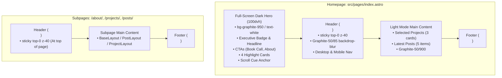

# Technical Design: Refine Hero Section of the Homepage

## Architecture Overview

The homepage architecture for `keolo.com` is refactored to decouple the hero section from the default inner `<main>` container and position the primary site navigation directly below the initial fold.



---

## Project Directory Structure

```text
src/
├── components/
│   ├── Header.astro           # Sticky navigation header (reusable on homepage and subpages)
│   ├── Footer.astro           # Site footer
│   ├── MotionReveal.astro     # Scroll-triggered reveal animation component
│   └── SEOHead.astro          # Structured metadata, JSON-LD, OpenGraph
├── layouts/
│   ├── BaseLayout.astro       # Refactored to accept headerPlacement?: 'top' | 'below-hero' | 'none'
│   ├── PostLayout.astro       # Uses BaseLayout with headerPlacement='top' (default)
│   └── ProjectLayout.astro    # Uses BaseLayout with headerPlacement='top' (default)
├── pages/
│   ├── index.astro            # Refactored: renders full-screen dark hero, then Header, then light content
│   ├── about.astro            # Standard top header
│   ├── projects/              # Standard top header
│   └── posts/                 # Standard top header
└── styles/
    └── global.css             # Tailwind v4 Graphite color tokens and base rules
```

---

## Key Component Seams & Technical Decisions

### 1. Flexible Header Placement in `BaseLayout.astro`

`src/layouts/BaseLayout.astro` currently hardcodes `<Header />` as the first child of `<body>` and places all slot content inside an inner `<main class="mx-auto w-full max-w-5xl flex-1 px-4 pt-10 sm:px-6 lg:px-8">`.

To cleanly support placing the full-screen hero above the navigation without breaking any subpage, `BaseLayout.astro` is enhanced with:

```typescript
export interface Props {
  title: string;
  description?: string;
  image?: string;
  type?: 'website' | 'article';
  tags?: string[];
  jsonLd?: Record<string, unknown>;
  headerPlacement?: 'top' | 'below-hero' | 'none';
}

const {
  title,
  description,
  image,
  type,
  tags,
  jsonLd,
  headerPlacement = 'top',
} = Astro.props;
```

In the template:
- When `headerPlacement === 'top'` (default for all subpages and article layouts), `<Header />` is rendered at the top of `<body>`.
- When `headerPlacement === 'below-hero'`, `BaseLayout` supports rendering a named `slot="hero"` (or top-level hero section) prior to rendering `<Header />`, followed by `<main>` for the remaining page content.
- `<Header />` maintains its existing `sticky top-0 z-40` CSS class. When rendered immediately following the hero section, the browser's native CSS sticky positioning keeps the header parked below the fold initially, and then locks it to the top of the viewport (`top: 0`) as the user scrolls into the `<main>` content container.

### 2. Full-Screen Dark Hero Layout (`src/pages/index.astro`)

The hero section is styled with:
- **Container Height & Surface**:
  - `w-full min-h-screen min-h-[100dvh] bg-graphite-950 text-white flex flex-col justify-between px-4 py-8 sm:px-6 sm:py-12 lg:px-8 lg:py-16`
  - Uses `min-h-[100dvh]` to account for dynamic mobile browser address bars (Chrome, Safari iOS) and prevent layout jumping or cut-off content.
- **Inner Content Max-Width**:
  - `mx-auto w-full max-w-5xl flex-1 flex flex-col justify-center`
- **Typography & Color Hierarchy**:
  - **Pill Badge**: `inline-flex items-center gap-2 rounded-full border border-graphite-800 bg-graphite-900/80 px-3.5 py-1 text-xs font-medium text-graphite-300 shadow-inner`
  - **Main Heading**: `text-4xl font-bold tracking-tight text-white sm:text-5xl sm:leading-[1.1]`
  - **Bio Copy**: `text-lg leading-relaxed text-graphite-300 sm:text-xl` with high-emphasis spans in `text-white` and link to Aliveness Ventures in `text-graphite-200 underline decoration-graphite-600 hover:decoration-white`
  - **Primary CTA ("Book a Call")**: `inline-flex items-center gap-2 rounded-lg bg-white px-5 py-3 text-sm font-medium text-graphite-950 shadow-md transition hover:bg-graphite-200 focus-visible:outline-2 focus-visible:outline-offset-2 focus-visible:outline-white`
  - **Secondary CTA ("About & Engagement Models")**: `inline-flex items-center gap-2 rounded-lg border border-graphite-800 bg-graphite-900/60 px-5 py-3 text-sm font-medium text-graphite-200 transition hover:border-graphite-700 hover:bg-graphite-800 hover:text-white`
  - **Highlight Metric Cards**: `grid gap-4 sm:grid-cols-2 lg:grid-cols-4 mt-12`; cards use `rounded-2xl border border-graphite-800/80 bg-graphite-900/40 p-5 backdrop-blur-sm transition hover:border-graphite-700 hover:bg-graphite-900/70`, with card headings in `text-white` and details in `text-graphite-400`.
- **Scroll Down Indicator**:
  - A subtle bottom cue (`<a href="#content" class="inline-flex items-center gap-1.5 text-xs font-medium text-graphite-400 hover:text-white transition">...</a>`) positioned at the base of the hero fold for intuitive discovery.

### 3. Native CSS Sticky Behavior Below Hero

Because `<Header />` has classes:
```html
<header class="sticky top-0 z-40 border-b border-graphite-200/80 bg-graphite-50/85 backdrop-blur-md">
```
When placed after the `100dvh` hero section in the standard document flow:
1. At `scrollY = 0`, the header sits at the bottom edge of the hero fold (offscreen or right below the fold).
2. As the visitor scrolls down, the header smoothly slides into view.
3. Once the top of the header hits `top: 0` of the browser viewport, it locks into place (`sticky`), staying fixed while the visitor browses Projects, Posts, and Footer.
4. When scrolling back up, it returns to its document position below the hero seamlessly with zero JavaScript event listeners or layout reflows.

### 4. Responsive Viewport Adaptability & Mobile Handling

- Mobile screens (320px–480px width) have limited vertical height:
  - Hero margins and padding adjust (`py-8` on mobile vs `py-16` on desktop).
  - Highlight cards switch from 4 columns (`lg:grid-cols-4`) to 2 columns (`sm:grid-cols-2`) or 1 column on extra-small mobile.
  - Highlight text uses compact, high-density padding (`p-4` on mobile, `p-5` on desktop) ensuring the entire hero easily fits in the initial fold without requiring internal scrolling.

### 5. Automated Verification & Testing Strategy

- **`src/lib/__tests__/site-build.test.ts`**:
  - Add test asserting that `src/pages/index.astro` contains full-screen hero tokens (`min-h-[100dvh]`, `bg-graphite-950`).
  - Add test asserting that `BaseLayout.astro` correctly renders `<Header />` below the hero on the homepage while preserving top header rendering on subpages.
  - Verify WCAG contrast compliance for dark-mode text and interactive buttons.

---

## Failure Modes & Recovery Matrix

| Failure Mode | Detection Point | Handling / Recovery |
| :--- | :--- | :--- |
| Hero exceeds 100dvh on mobile and gets clipped | Mobile viewport visual inspection (iPhone SE 375x667) | Use flexible padding (`py-6 sm:py-12`), compact highlight card padding (`p-4`), and `min-h-[100dvh] flex flex-col justify-between`. |
| Header fails to stick after scrolling past hero | Desktop and mobile scroll test | Ensure parent container of `<Header />` has no `overflow: hidden` or `overflow: clip` which disables CSS `sticky`. |
| Subpage navigation header missing or displaced | Automated test in `site-build.test.ts` & visual regression check | Default `headerPlacement='top'` in `BaseLayout.astro`; verify `/about/`, `/projects/`, `/posts/` render header at top. |
| Inadequate text contrast on dark hero background | Contrast audit with WCAG AA checker | Enforce `text-white` for headings, `text-graphite-300` (ratio > 7:1 on #09090b) for body, and high-contrast solid button states. |
| Reduced motion users see unwanted animations | Automated check against `prefers-reduced-motion` | Scroll cues and motion reveals disable transforms and pulsing when `prefers-reduced-motion: reduce` is detected. |
