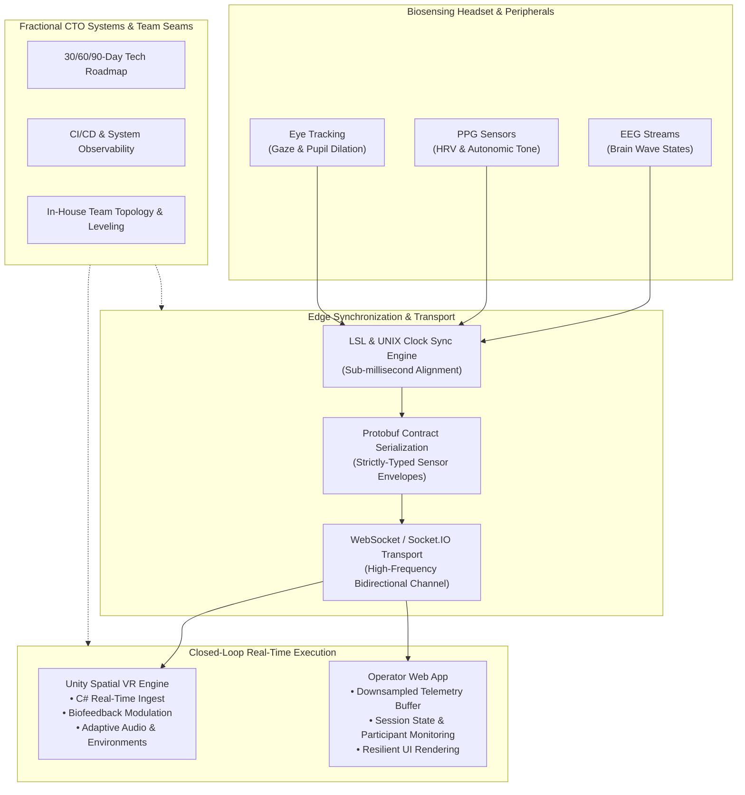
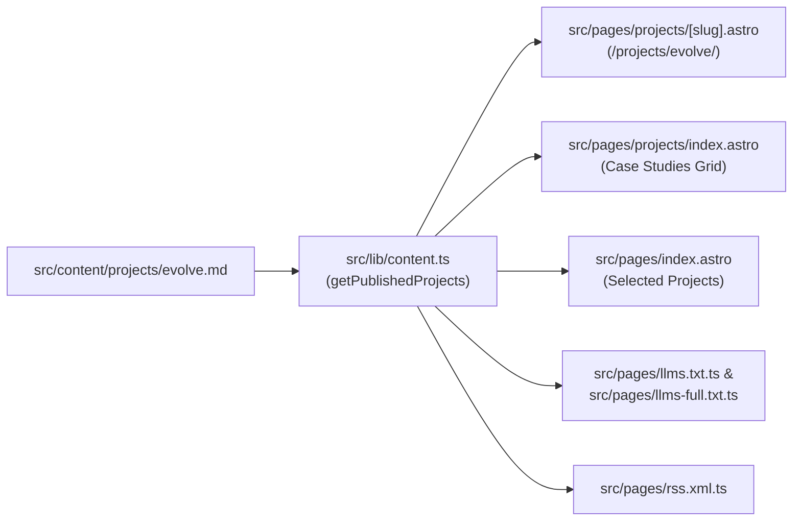

# Technical Design: Project Case Study: Evolve

## Architecture Overview

The Evolve case study documents an advanced human performance platform uniting hardware biosensors, spatial computing, and real-time telemetry streaming into a closed-loop neuro-adaptive system.



---

## Content Model & Frontmatter Schema

The case study is stored as a Markdown document in `src/content/projects/evolve.md` matching the `projects` Content Collection schema in `src/content.config.ts`:

```typescript
// Astro Content Collection Schema (src/content.config.ts)
const projects = defineCollection({
  loader: glob({ pattern: '**/*.md', base: './src/content/projects' }),
  schema: z.object({
    title: z.string(),
    description: z.string(),
    draft: z.boolean().default(false),
    weight: z.number().default(100),
    tags: z.array(z.string()).default([]),
    cover: z
      .object({
        image: z.string(),
        alt: z.string().optional(),
      })
      .optional(),
    gallery: z
      .array(
        z.object({
          src: z.string(),
          alt: z.string(),
        })
      )
      .default([]),
    showtoc: z.boolean().optional(),
  }),
});
```

### Frontmatter Configuration for `evolve.md`:
```yaml
---
title: 'Evolve'
description: 'Architecting a closed-loop human performance platform uniting multimodal biosensing (EEG, PPG, eye tracking) and real-time virtual reality.'
draft: false
weight: 15
showtoc: false
tags:
  - 'Fractional CTO'
  - 'Biosensing'
  - 'Virtual Reality'
  - 'Real-Time Streaming'
  - 'Systems Architecture'
---
```

---

## Sanitization & Privacy Boundary Matrix

To strictly enforce the user requirement ("Don't include specifics since this go on a public website"), the following data classification boundary is enforced:

| Classification | Topic / Data Element | Public Case Study Treatment | Prohibited Proprietary Specifics |
| :--- | :--- | :--- | :--- |
| **Identities** | Client personnel, advisors, candidates | Executive framing ("Fractional CTO & Systems Advisor collaborating with founders and engineering team") | No personal names (e.g. Lyle, Jon, Lauren, Larry, Michal) or employee contact info |
| **Financials** | Capital structure & fundraising | General venture stage ("growth-stage deep-tech startup", "investor readiness") | Zero specific dollar amounts ($50M, $15M+, $10M) or cap table details |
| **Internal Docs** | Architecture reviews, PRDs, backlog | General engineering methodologies (PRD to TDD mapping, sprint cadence, team topology) | Zero links to private Google Docs, JIRA workspaces, or diagnostic PDFs |
| **Hardware / Firmware** | Sensor headset engineering | Architectural integration patterns (Protobuf contracts, clock sync between LSL and UNIX epoch, sensor concurrency) | Proprietary firmware source code, unpatented mechanical schematics, vendor defect logs |
| **Commercial Pilots** | Government & enterprise trials | High-stakes validation environments ("enterprise and performance training pilots") | Specific client/customer names, confidential defense procurement references |

---

## Site Integration Seams



1. **Routing Seam (`src/pages/projects/[slug].astro`)**:
   Automatically discovers `evolve.md` via `getPublishedProjects()`, rendering the page through `ProjectLayout.astro`.
2. **Catalog Index Seam (`src/pages/projects/index.astro`)**:
   Presents Evolve alongside existing case studies (`JOYO`, `Global Peace Yes`, `Riiu`). The grid adapts smoothly to four cards (`md:grid-cols-2 lg:grid-cols-4` or responsive flex/grid).
3. **Homepage Seam (`src/pages/index.astro`)**:
   Exposes Evolve in the Selected Projects section.
4. **Machine-Readable LLM Index Seams (`/llms.txt`, `/llms-full.txt`)**:
   Dynamically aggregates Evolve's executive summary and full prose content into plain-text endpoints for AI crawlers.
5. **Static Diagram Build Pipeline (`src/lib/mermaid.ts`)**:
   Compiles all Markdown Mermaid code blocks into inline SVGs during `astro build`.

---

## Key Component Seams & Technical Decisions

### 1. Build-Time Static Architecture Diagrams via Mermaid v13
The case study includes two build-time diagrams:
- **System Architecture Diagram**: Flow from multimodal biosensing headset through edge clock synchronization and Protobuf contracts to Unity VR real-time modulation and the operator telemetry dashboard.
- **Fractional CTO Leadership Timeline**: Structured progression across Discovery & Audit, Streaming Contract & Protocol Stabilization, Operator Telemetry Protection, and In-House Team Transition.

### 2. Gallery Asset Fallback Resilience
Because pre-commercial pilot hardware photography is subject to non-disclosure restrictions, `evolve.md` sets `gallery: []`. `ProjectLayout.astro` conditionally renders `<Carousel />` only when `gallery.length > 0`, ensuring clean typography and zero broken layout blocks.

---

## Quality Verification & Test Plan

1. **Astro Schema & Lint Validation**: Run `pnpm run check` (`astro check`) and `pnpm run lint` to guarantee complete TypeScript and Markdown validity.
2. **Automated Sanitization Test**:
   Add test cases in `src/lib/__tests__/site-build.test.ts` verifying:
   - Case study exists and resolves under `/projects/evolve/`.
   - Disallowed strings (confidential names, private doc URLs, dollar amounts) are absent from `evolve.md` and compiled output.
   - Frontmatter conforms to Astro Content Collection schema.
3. **Deterministic Gate Audit**: Execute `alv gate check dor alv/changes/2026-11-25-project-case-study-for-evolve-don-t-include` ensuring 100% compliance across Layers 1, 2, and 3.
