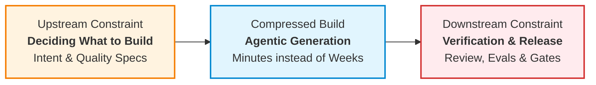
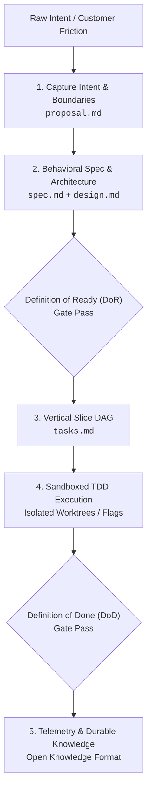
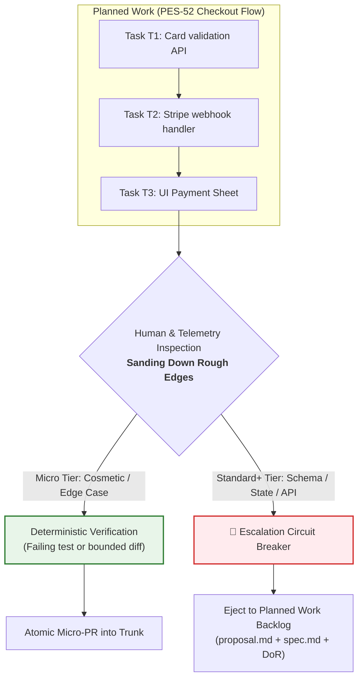
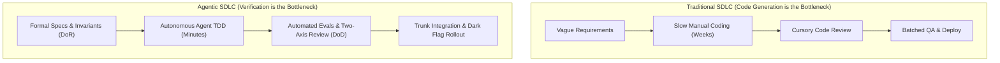

In the traditional software delivery lifecycle, engineering teams lived and died by a six-stage pipeline:

```
Plan → Design → Build → Test → Deploy → Maintain
```

For decades, the **Build** phase consumed the lion's share of engineering time, budget, and mental energy. Writing syntax, wiring controllers, plumbing database schemas, and wrestling with CSS took weeks or months. Every surrounding ritual—sprint estimation, requirements gathering, architectural reviews, QA testing, and release cabals—was calibrated around that deliberate, human-speed building tempo.

Then autonomous AI coding agents arrived.

Tools powered by modern frontier models have compressed the Build phase by an order of magnitude. What once took an engineer three days of focused typing can now be generated, refactored, and passed through unit tests in fifteen minutes.

At first glance, this looks like an unalloyed productivity revolution. But as any student of Eliyahu Goldratt’s *Theory of Constraints* knows: **if you 100x the throughput of one stage in a pipeline without fundamentally restructuring the rest, you do not speed up the system. You just create an catastrophic inventory bottleneck.**

Today, engineering teams face an acute Work-In-Progress (WIP) crisis. AI agents are generating code faster than organizations can specify what to build, and far faster than humans can review, verify, and safely release it. 

To survive agentic software development, we have to rethink how work enters the system—and fundamentally distinguish between **Planned** and **Unplanned** work.

---

## The Shifting Bottleneck of the AI SDLC

When the center of the pipeline collapses, the constraints move aggressively to the edges:



1. **The Upstream Constraint: Deciding What to Build**  
   If you feed an AI agent vague prompts, hand-waving PRDs, or half-baked feature ideas, it won't push back and ask clarifying questions like a senior engineer would over coffee. It will hallucinate plausible assumptions, invent silent defaults, and generate hundreds of lines of syntactically flawless code that implements the wrong thing. The upstream bottleneck is now **clarifying intent and authoring unambiguous behavioral specifications**.

2. **The Downstream Constraint: Verification, Review, and Authorization**  
   More code is hitting manual review queues designed for a trickle of human output. Senior engineers are drowning in 1,200-line diffs generated in seconds. Rubber-stamping PRs leads to silent regressions, while painstakingly parsing every agent-generated token grinds team velocity to a halt. The downstream bottleneck is now **automated verification, behavioral evals, and enforced release gates**.

Anthropic's engineering playbook and industry-leading AI SDLC architectures (such as the [Aliveness Product Engineering System](https://github.com/aliveness-dev)) resolve this bottleneck by surrounding agentic execution with versioned artifacts, automated checks, and deterministic feedback loops.

The blueprint for this modern delivery pipeline rests on six operational pillars:

- **Capture Intent**: Interrogate problem statements and outcomes before authoring code.
- **Produce Requirements Using Standards**: Leverage machine-readable specifications like OpenSpec with Given/When/Then scenarios.
- **Equip Agents with Reusable Components**: Anchor models with curated domain concepts, golden libraries, and institutional invariants.
- **Run Tests Continuously, Including Evaluations**: Enforce strict Test-Driven Development (TDD) and multi-turn behavioral evaluations.
- **Automate Review with Enforced Gates & Human Accountability**: Decouple spec reviews from code reviews, gate merges through Definition of Ready (DoR) and Definition of Done (DoD), and maintain clear human ownership.
- **Feed Production Findings Back into Planning**: Route telemetry and incident post-mortems back into durable knowledge.

Within this framework, the line between **Planned** and **Unplanned** work must be drawn with surgical precision.

---

## Planned Work in Agentic Development

Planned work represents deliberate, value-generating capability expansion. In an agentic SDLC, planned work is never defined as "writing code." **Planned work is the systematic transformation of raw intent into verified system behavior.**



Here is how each dimension of planned work operates when agents do the heavy lifting:

### 1. When There Are No Clear Specs: Stop Execution
In traditional engineering, teams frequently threw engineers at poorly specified tickets, expecting them to "figure it out as they code." With AI agents, doing this is organizational suicide. 

When specifications are fuzzy or absent, **generating code is strictly prohibited**. That work is not an implementation task; it is an upstream planning task. 

Before an agent touches a repository:
- Run structured intent extraction (`/capture-intent`) to drill into user personas, core friction, target metrics, and explicit non-goals.
- Translate business goals into observable behavioral contracts using standards like [OpenSpec](https://openspec.dev/) with formal RFC 2119 keywords (`SHALL`, `MUST`, `MAY`).

If the specification cannot be verified deterministically, the feature is not ready for an agent.

### 2. Acceptance Criteria as Executable Contracts
In an agentic workflow, acceptance criteria are not hand-wavy bullet points in Jira. They are formal, scenario-driven contracts:

```markdown
### Requirement: Idempotent Payment Settlement
The billing engine SHALL settle authorization holds idempotently within a 72-hour window.

#### Scenario: Duplicate webhook receipt
- GIVEN an authorized transaction hold with ID `tx_123`
- WHEN the settlement webhook is received multiple times with identical payload
- THEN the system SHALL execute the ledger entry exactly once
- AND return HTTP 200 with the original settlement timestamp
- AND emit an idempotent duplicate warning metric to telemetry
```

Because these scenarios follow strict Given/When/Then structures, the agent can directly translate them into red-green test suites during the build phase. Acceptance criteria are the rails that prevent the agent from wandering off into speculative refactors.

### 3. Definition of Ready (DoR) and Definition of Done (DoD)
Quality gates must be enforced programmatically rather than left to reviewer goodwill:

- **Definition of Ready (DoR)**: The gate that protects the Build phase. Before an agent provisions an isolated Git worktree or writes a test, the proposal, research evidence, behavioral scenarios, and technical design (`design.md`) must pass peer critique (`/verify-gates`).
- **Definition of Done (DoD)**: The gate that protects main trunk. A task is not done when the agent says "I've implemented the feature." It is done when:
  1. All unit, integration, and contract tests pass with 100% scenario coverage.
  2. Linters, formatters, and static security analyzers run clean.
  3. The change is isolated behind a dark feature flag (`default: false`).
  4. Architectural choices are codified in an immutable Decision Record.

### 4. Progressive Rigor for Planned Capabilities
Not all planned work requires the same administrative weight. Teams should scale artifact ceremony to risk and blast radius using **Progressive Rigor**:

| Tier | Trigger | Required Artifacts | Review Seam |
| :--- | :--- | :--- | :--- |
| **Standard Tier (`tier: standard`)** | New API endpoint, schema mutation, or state machine modification | Full `proposal.md`, `spec.md`, `design.md`, `tasks.md` | Bifurcated review: Spec PR approval, followed by execution PRs |
| **Major Tier (`tier: major`)** | Multi-system refactor, billing architecture overhaul, cross-repo contract | Full PRD, research evidence, OKF domain model, DRs, sliced DAG | Formal architecture review and multi-agent execution |

If a change modifies public contracts, mutates state machines, or introduces new infrastructure, it belongs in one of these planned tiers. It demands explicit intent, formal Given/When/Then scenarios, and a verified Definition of Ready before an agent writes a single line of production code.

### 5. Estimating Scope and Timelines
Traditional estimation techniques (story points, planning poker, typing hours) are broken in an agentic world. An agent doesn't care if an algorithm takes 50 lines or 500 lines of boilerplate.

In an agentic SDLC, scope and timeline estimation shifts to four new metrics:
- **Specification Ambiguity**: How many unknown domain interactions or edge cases remain unresolved?
- **Dependency Depth (DAG)**: How many sequential vertical slices (`tasks.md`) are required? Independent tasks can run across parallel agent worktrees; deep sequential dependency chains determine the critical path.
- **Blast Radius**: How many existing contracts, shared schemas, or downstream services are touched?
- **Verification Latency**: How long does it take for CI suites, containerized sandboxes, and behavioral evals to execute and prove correctness?

### 6. Why the Change Was Made: Durable Knowledge
One of the most dangerous side effects of agentic development is **institutional amnesia**. An agent generates code in an ephemeral context window. Once the PR merges and the chat session terminates, the reasoning behind subtle edge cases evaporates.

Planned work is not finished until that reasoning is codified into durable knowledge. 

Using structured documentation formats like the Open Knowledge Format (OKF) in `docs/concepts/`, teams capture system invariants discovered during the build:

```markdown
---
id: "concept:ledger-idempotency-invariants"
title: "Ledger Settlement Idempotency & Webhook Invariants"
status: "verified"
confidence: 0.98
sources:
  - "specs/changes/2026-11-18-billing-settlement/spec.md"
---

# Ledger Settlement Invariants
All payment settlement operations must acquire a distributed Redis lock keyed on the idempotency token before mutating the double-entry balance ledger.
```

By persisting invariants in repository-level concepts, future agent runs read these files as ground-truth context, permanently immunizing your codebase against recurring architectural mistakes.

---

## Unplanned Work in Agentic Development

In traditional agile setups, "unplanned work" was a catch-all dumpster fire: critical production outages, sudden customer escalations, scope creep disguised as "quick asks," and surprise refactorings that hijacked entire two-week sprints.

In an agentic SDLC, we redefine unplanned work with strict, disciplined boundaries:

> **Unplanned work consists exclusively of small bug fixes, edge-case remediation, and post-build polish—sanding down the rough edges of an already planned and specified work item.**



### The Reality of "Sanding Down Rough Edges"
When an autonomous agent implements a planned vertical slice, it builds strictly to the letter of the specification. The tests pass, the linter is green, and the acceptance scenarios are satisfied. 

Yet the moment an engineer checks out the worktree and actually uses the software, human intuition and empirical experience kick in:
- A button tooltip clips against the screen edge on smaller viewports.
- An empty state abruptly shows blank space instead of a helpful call-to-action.
- An error message says `"Error: 422"` instead of explaining what form field failed validation.
- A trailing decimal in currency calculations behaves unexpectedly when pasted from an external invoice.

This post-implementation polish is not a failure of planning. Software is an empirical discipline; using a tangible system reveals ergonomic friction and boundary conditions that no team could fully anticipate in an abstract design document. 

This is the legitimate home of unplanned work: **sanding down the rough edges**.

### Does Unplanned Work Need Specs?
Engineering leaders often wrestle with a false dilemma when managing unplanned work:
1. **The Bureaucratic Trap**: Demanding that an engineer author a full `proposal.md`, `spec.md`, `design.md`, and DAG for a 3-line CSS fix or a null-coalescing check. This creates paralyzing friction, and engineers will predictably abandon the process.
2. **The Prompt-and-Pray Chaos**: Giving an agent an unconstrained prompt like *"clean this UI up"* or *"fix that edge case."* Without boundaries, the model hallucinates new dependencies, refactors ten unrelated files, introduces silent regressions, and destroys architectural consistency.

The answer is: **Unplanned work does not need a new specification document; it needs a deterministic verification anchor.**

Depending on the nature of the rough edge, that anchor takes one of two forms:

#### 1. Behavioral & Logic Edges: The Test is the Spec
If the unplanned work addresses a bug, a missing edge case, or unexpected logic behavior, do not write a markdown document. **The failing test is your specification.**
- Point the agent to the failing condition.
- Require the agent to write a minimal, red-green test reproducing the defect (e.g., passing an empty array or an unformatted phone number).
- Once the test fails predictably, instruct the agent to write the minimal production code needed to turn it green without altering surrounding logic.
- Optionally append the scenario directly into the parent feature's `spec.md` as an addendum scenario to keep the durable contract evergreen.

#### 2. Cosmetic & Ergonomic Polish: Bounded Context & Diff Verification
If the unplanned work involves visual polish, copy tweaks, or UX smoothing:
- Keep the agent's context window tightly bounded to the target component file (e.g., `git checkout -b polish/checkout-empty-state`).
- Provide an explicit, declarative delta: *"In `PaymentSheet.tsx`, replace the blank state with `<EmptyState>` using copy 'No payment methods found' and center the action button."*
- Prohibit the agent from touching shared themes, installing new UI packages, or refactoring sibling components.
- The human verifies the resulting git diff directly. If the diff exceeds the expected blast radius, reject it immediately.

### The Iron Rule: Unplanned Work is Exclusively Micro-Tier
This brings us to a fundamental architectural principle: **If work is Standard Tier or above, it can NEVER be unplanned.**

By definition:
- **Micro Tier (`tier: micro`)**: Localized bug fixes, cosmetic polish, edge-case tests on an active task. This is the **only** tier permitted to execute as unplanned work.
- **Standard Tier (`tier: standard`)**: New database migrations, schema field additions, new API routes, state machine transitions, or security permission updates.
- **Major Tier (`tier: major`)**: Cross-boundary refactors, billing infrastructure rewrites, multi-system architectural contracts.

The moment an unplanned discovery requires a new database column, modifies a state machine, alters a public API contract, or impacts security invariants, **it is no longer "sanding down edges." It is an architectural change.**

### The Escalation Circuit Breaker
What happens when an engineer starts investigating a minor rounding error and discovers that the underlying payment ledger lacks concurrency protection?

**In agentic engineering, you must never allow an agent to patch structural flaws through ad-hoc chat prompts.**

```
[Unplanned Work: Sanding Rough Edges]
                  │
                  ▼
   Does it touch any of these?
   ├── Database schemas or retention policies
   ├── Established Given/When/Then contracts
   ├── State machine transitions
   ├── Authentication & security invariants
   └── External dependencies or services
                  │
          ┌───────┴───────┐
         YES              NO
          │               │
          ▼               ▼
  [🚨 Circuit Breaker]   [TDD Micro-Fix]
  Eject to Planned Work   Merge to Trunk
```

If an unplanned discovery crosses the escalation boundary, the **Escalation Circuit Breaker** trips:
1. **Halt Build Execution**: Stop prompting the agent in the active worktree. Do not allow speculative refactoring.
2. **Eject to Planned Backlog**: File a new tracked capability item under the **Standard Tier**.
3. **Run Upstream Planning**: Author the necessary `proposal.md`, specify the new behavior in `spec.md`, design the migration in `design.md`, and pass the Definition of Ready (DoR) gate before returning to code.

By enforcing this boundary, you preserve developer velocity for everyday polish while protecting the codebase against the insidious architectural rot that rapid AI generation invites.

---

## Operating Principles for the Agentic Delivery Pipeline

Adapting to this model requires rethinking how engineering teams measure success, conduct reviews, and allocate cognitive effort:



### 1. Verification is the Scarce Currency
Generating code has a marginal cost approaching zero. Verifying that code is secure, idiomatic, resilient, and compliant has a very high cost. Treat test harnesses, contract verifiers, and behavioral evaluation suites as your primary engineering assets. Code is ephemeral; verification harnesses are permanent.

### 2. Bifurcate the Review Seam
Do not review specifications and code diffs in the same pull request. 
- **Seam 1: The Specification Review**: The team reviews and signs off on `proposal.md`, `spec.md`, and `design.md`. Once this clears, intent and architecture are locked.
- **Seam 2: The Execution Review**: The team reviews the agent's pull request solely against the agreed-upon specification. Did the tests faithfully implement the Given/When/Then scenarios? Did the linter pass? If yes, merge.

Decoupling these reviews prevents senior engineers from debating product requirements inside a 500-line git diff.

### 3. Maintain Trunk Safety with Dark Feature Flags
Because agents complete tasks in small vertical slices, long-lived feature branches are obsolete. Every vertical slice merges directly to main trunk. Incomplete features remain dark behind boolean feature flags (`flag:checkout_v2: false`). This guarantees that code does not drift, CI runs continuously across the entire system, and release authorization is decoupled from code deployment.

### 4. Human Accountability Over Agent Autonomy
Agents are exceptional copilots and autonomous execution engines inside sandboxes, but they cannot be held accountable for production outages, data breaches, or compliance violations. 

Enforce a strict separation of concerns:
- **Agents** propose specifications, generate red-green tests, write implementations, and diagnose errors.
- **Humans** review gates, authorize releases, and own the final outcome.

---

## The Organizational and Cultural Challenge

Adopting an agentic SDLC is fundamentally not a tooling problem. It is a cultural transformation.

Software engineering culture has spent four decades celebrating the heroic, caffeine-fueled developer who types thousands of lines of code into the night without a spec. Performance reviews rewarded raw output: commits made, lines authored, PRs opened.

In an agentic organization, that dynamic inverts:
- The engineer who writes 1,000 lines of un-specced code is a liability who creates review bottlenecks and technical debt.
- The engineer who takes the time to author crystal-clear behavioral specifications, establishes strict TDD guardrails, and codifies durable domain knowledge is the high-leverage multiplier.

When you remove the friction of writing syntax, you expose every organizational dysfunction that was previously hidden behind slow build times: fuzzy product roadmaps, political disagreements over architecture, brittle CI pipelines, and sluggish review cycles.

The teams that thrive in the agentic era will not be those with the fastest prompts. They will be the teams that design a rigorous system of constraints, treat specifications as code, and continually eliminate the operational bottlenecks that AI speed lays bare.
