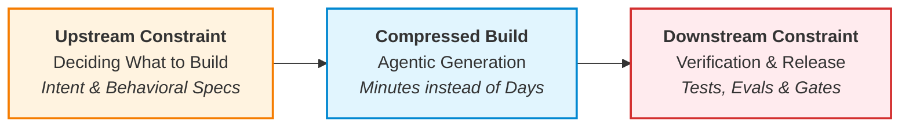
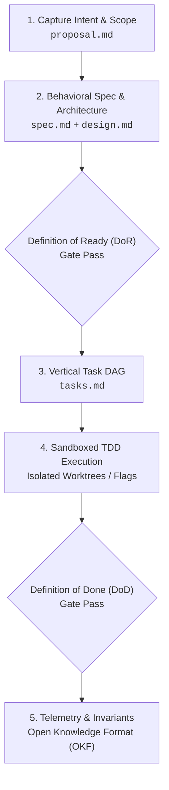
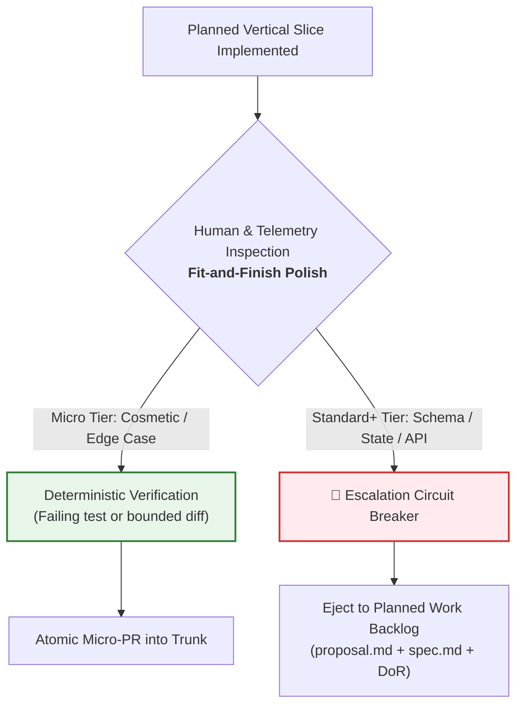
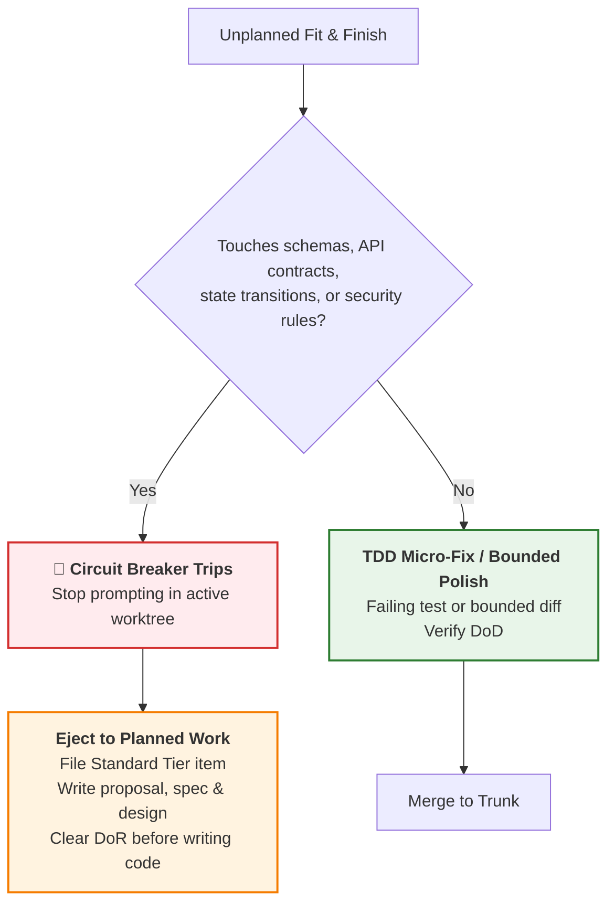

When writing code becomes nearly free, the economic foundation of software engineering flips.

For decades, writing code was the slowest, most expensive part of building software. Sprint planning, estimation poker, and architecture reviews were all designed around one basic fact: turning an idea into working syntax took weeks of typing. Because typing was slow, unplanned work was the enemy. A surprise bug, a missing edge case, or a sudden requirement change blew up delivery schedules.

AI coding agents changed that almost overnight. What used to take three days of focused typing can now be generated, wired up, and tested in fifteen minutes.

When code is this cheap to produce, an easy mistake is to assume we don't need to plan anymore: *If an agent can build anything in ten minutes, why plan at all? Isn't all work just prompt-and-iterate?*

That assumption quickly creates a massive inventory problem. As Eliyahu Goldratt showed in *The Goal*: **if you 100x the throughput of one stage in a pipeline without restructuring the rest, you don't speed up the system. You just pile up inventory in front of the next bottleneck.**

Today, that inventory is unreviewed, unverified code. Agents generate pull requests far faster than teams can decide what they want, and far faster than humans can review, test, and safely deploy.



When code is free, generating un-specced software is the fastest way to wreck an architecture. To keep velocity high without losing control of quality, you have to split work into two distinct categories:

| Dimension | Planned Work | Unplanned Work (Fit & Finish) |
| :--- | :--- | :--- |
| **Purpose** | Deliberate capability expansion | Localized bug fixes, edge cases & UX polish |
| **Trigger** | Roadmap intent, customer problem | Testing the live branch post-build |
| **Permitted Tiers** | Standard Tier & Major Tier | Micro Tier only (`tier: micro`) |
| **Artifacts** | `proposal.md`, `spec.md`, `design.md`, `tasks.md` | Failing test (logic) or bounded diff (UI) |
| **Quality Gate** | Formal DoR before code; DoD before merge | Targeted regression test / PR diff review |

---

## Planned Work: Turning Intent into Software

Planned work is deliberate capability expansion. When an agent can write 500 lines of syntax in thirty seconds, planning is where actual engineering leverage lives.



### 1. No Spec Means No Code
If you feed an agent a vague ticket, it won't push back or ask clarifying questions. It fills in blanks with plausible guesses and writes hundreds of lines of clean code that solves the wrong problem.

If a feature cannot be described with clear, testable scenarios, an agent shouldn't touch it. Upstream planning must first establish:
- The problem statement, target users, and explicit non-goals (`proposal.md`).
- Behavioral contracts with verifiable Given/When/Then scenarios using standards like [OpenSpec](https://openspec.dev/).

### 2. Executable Acceptance Contracts
Acceptance criteria aren't casual bullet points in a tracker. They are formal contracts that directly anchor the agent's test suite:

```markdown
### Requirement: Idempotent Payment Settlement
The billing engine SHALL settle authorization holds idempotently within 72 hours.

#### Scenario: Duplicate webhook receipt
- GIVEN an authorized transaction hold with ID `tx_123`
- WHEN the settlement webhook is received multiple times with identical payload
- THEN the system SHALL execute the ledger entry exactly once
- AND return HTTP 200 with the original settlement timestamp
```

The agent converts these scenarios directly into red-green test suites during the build, eliminating speculative refactoring.

### 3. Progressive Rigor for Planned Changes
Not every planned feature requires a heavy administrative footprint. Scale documentation ceremony to the blast radius:

- **Standard Tier (`tier: standard`)**: New endpoints, database migrations, state machine changes. Requires `proposal.md`, `spec.md`, `design.md`, `tasks.md`, and bifurcated review (spec approved before code is written).
- **Major Tier (`tier: major`)**: Multi-system overhauls, billing redesigns, cross-repo contracts. Full PRD, research evidence, domain modeling, Decision Records, and architecture review.

### 4. Enforcement Gates: DoR and DoD
- **Definition of Ready (DoR)**: Protects the build step. Code generation is blocked until proposal, specs, design, and task slices clear peer review.
- **Definition of Done (DoD)**: Protects trunk. Code does not merge until all scenario tests pass, linters run clean, dark feature flags isolate incomplete features, and decisions are recorded.

---

## Unplanned Work: Fit and Finish

If planned work covers capability expansion, what actually counts as **unplanned work** when code is free?

In an agentic SDLC, unplanned work has a specific, practical role:

> **Unplanned work consists exclusively of localized bug fixes, edge-case remediation, and post-build fit-and-finish polish on an already specified work item.**

### The Reality of Fit and Finish
You spec a feature, an agent builds it in a clean worktree, all unit tests pass, and DoR/DoD are satisfied. Then you pull the branch, run it locally, and start clicking around.

Reality surfaces friction that no design document could foresee:
- An empty state shows blank space instead of a helpful onboarding prompt.
- An error toast says `Error: 422` instead of identifying which input field was invalid.
- A button tooltip clips off-screen on smaller viewports.
- A currency input fails when pasting values containing whitespace or symbols.

This isn't a failure of planning. Software is an empirical craft. Using a working system reveals ergonomic gaps and edge cases that are difficult to anticipate in an abstract markdown file. This last-mile polish—the **fit and finish**—is the true domain of unplanned work.



### Does Fit and Finish Need Specs?
When handling last-mile polish, teams usually fall into two traps:
1. **The Bureaucracy Trap**: Demanding a full `proposal.md`, `spec.md`, and task DAG to fix 8px of padding or handle a null check. Developers will immediately bypass the process.
2. **The Prompt-and-Pray Trap**: Giving an agent loose prompts like *"make this form look better."* Without constraints, models hallucinate new dependencies, rewrite shared styles, and introduce regressions.

**Unplanned work does not need a spec document; it needs a deterministic verification anchor:**

- **For Logic & Edge-Case Bugs: The Test is the Spec.** Point the agent to the failing condition, have it write a minimal red-green test reproducing the bug, make it pass with the smallest possible diff, and append the scenario to the parent spec.
- **For Visual & Ergonomic Polish: Bounded Context & Diff Review.** Restrict the agent's context strictly to the single component, provide an explicit declarative prompt (e.g., *"In `PaymentSheet.tsx`, replace the blank container with `<EmptyState>` and center the button"*), and inspect the git diff directly. If the diff touches outside files, reject it.

### The Iron Rule: Unplanned Work is Exclusively Micro-Tier
**If work is Standard Tier or above, it cannot be unplanned.**

- **Micro Tier (`tier: micro`)**: Localized fixes, cosmetic tweaks, edge-case tests. The **only** tier permitted as unplanned work.
- **Standard Tier (`tier: standard`)**: Schema migrations, new endpoints, state transitions, security changes.
- **Major Tier (`tier: major`)**: Cross-boundary architecture, core system rewrites.

The moment an unplanned discovery touches a database schema, alters a public API, or changes a state machine, **it is no longer fit-and-finish polish. It is an architectural change.**

### The Escalation Circuit Breaker
When investigating a minor edge case reveals that the underlying data model or auth flow is flawed, **never let an agent patch structural flaws through ad-hoc chat prompts.**



When the circuit breaker trips:
1. **Stop Implementation**: Halt ad-hoc prompting in the active worktree.
2. **Eject to the Backlog**: File a new **Standard Tier** item in the planned backlog.
3. **Plan Before Coding**: Author the proposal and spec, resolve technical design, and clear the DoR gate before writing code.

---

## Operating Principles for Agentic Delivery

1. **Verification is the Scarce Resource**: Code generation is cheap; confidence is expensive. Test harnesses, contract checkers, and evaluation suites are your primary engineering assets.
2. **Bifurcate the Review Seam**: Review specifications before reviewing code. Decoupling spec sign-off from diff inspection stops engineers from debating product requirements inside a 600-line pull request.
3. **Protect Trunk with Dark Feature Flags**: Agents ship small vertical slices. Merge frequently to trunk behind dark flags (`flag:checkout_v2: false`) to avoid merge debt while keeping deployment decoupled from release.
4. **Humans Own Outcomes**: Agents propose specs, write tests, generate code, and diagnose failures. Humans verify gates, approve releases, and remain accountable for production.

---

## The Cultural Shift

Adopting an agentic SDLC is a workflow transformation, not a tooling upgrade.

Traditional engineering culture celebrated the developer who typed thousands of lines of un-specced code. In an agentic organization, that developer creates review bottlenecks and technical debt.

When code is free, the high-leverage engineer is the one who clarifies intent, crafts unambiguous behavioral specifications, establishes strict verification guardrails, and knows exactly when to polish the fit-and-finish—and when to hit the circuit breaker.
