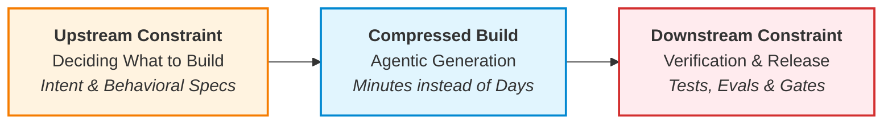
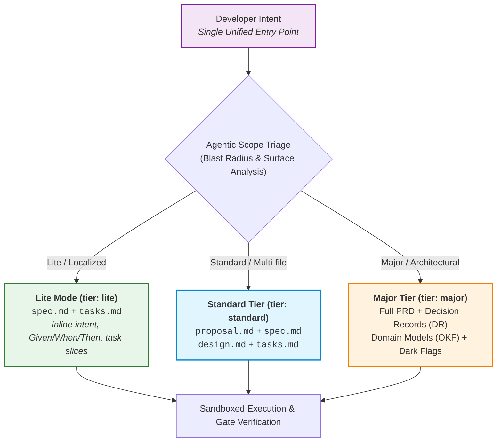
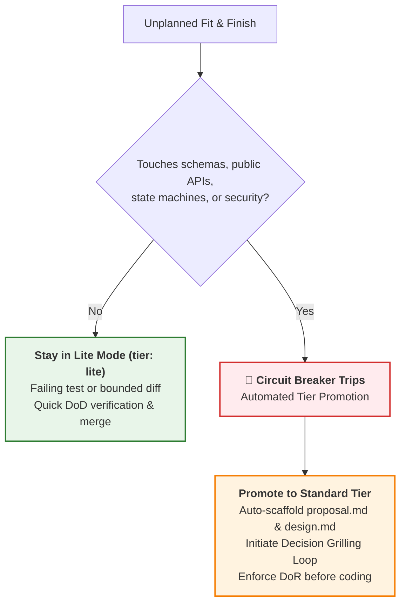

When writing code becomes nearly free, the economic foundation of software engineering flips.

For decades, writing syntax was the slowest, most expensive part of building software. Sprint planning, estimation poker, and change advisory boards all existed because turning an idea into working code took weeks of typing. Because typing was slow, unplanned work was the enemy. A surprise bug, an unhandled edge case, or a sudden requirement shift derailed entire roadmaps.

AI coding agents changed that almost overnight. What used to take three days of focused implementation can now be scaffolded, wired up, and tested in minutes.

When code is this cheap to produce, teams often make one of two mistakes:
1. **The Bureaucracy Trap**: Forcing developers to write multi-page PRDs, technical designs, and task tickets for every minor polish item. Developers quickly abandon the process.
2. **The Prompt-and-Pray Trap**: Abandoning planning entirely under the illusion that "the agent can just fix it in chat." Without behavioral contracts, agents hallucinate assumptions, mutate database schemas, and generate unmaintainable sprawl.

As Eliyahu Goldratt demonstrated in *The Goal*: **if you 100x the throughput of one stage in a pipeline without restructuring the rest, you don't speed up the system. You just pile up inventory in front of the next bottleneck.**



Today, that inventory is unreviewed, unverified code. To keep delivery fast without losing architectural integrity, we need a system where **the developer experience stays identical, while the system dynamically scales the rigor**.

---

## One Developer Experience, Progressive Rigor

In a modern Product Engineering System (PES), developers shouldn't have to fill out different administrative forms based on project size. The entry point is always the same: **state your intent**.

Whether you press `p` in a terminal dashboard or enter a prompt in a CLI, you provide the problem statement. The agentic system analyzes the prompt, inspects the codebase, assesses the blast radius, and **automatically categorizes the change into the appropriate tier**:



### 1. Lite Mode (`tier: lite`): Low Ceremony, High Velocity
For localized changes—a bug fix, a small UI tweak, or fit-and-finish polish—heavy documentation is wasteful. 

In Lite Mode, the system generates only two artifacts:
- **`spec.md`**: A single consolidated document containing inline Problem & Intent and 1–2 testable Given/When/Then scenarios using standards like [OpenSpec](https://openspec.dev/).
- **`tasks.md`**: Vertical task slices for the agent to implement.

No separate `proposal.md`, `research.md`, or `design.md` is created. The Definition of Ready (DoR) gate checks only that the scenarios and tasks are unambiguous, and implementation proceeds immediately.

### 2. Standard Tier (`tier: standard`): Architectural Safeguards
When a change introduces new API endpoints, database migrations, or state transitions, the system automatically escalates documentation ceremony:
- **`proposal.md`**: Problem statement, target personas, hypotheses, and explicit non-goals.
- **`spec.md`**: Exhaustive behavioral contracts (happy path, edge cases, failure states).
- **`design.md`**: Component boundaries, sequence diagrams, and migration rollback strategies.
- **`tasks.md`**: Sliced implementation DAG.

Code generation is blocked until specifications and designs clear peer review (bifurcated review).

### 3. Major Tier (`tier: major`): High-Blast-Radius Overhauls
For cross-repo migrations, billing engines, or auth overhauls, the system scales up to include Open Knowledge Format (OKF) domain concepts and formal Decision Records (`docs/decisions/DR-*.md`).

The developer experience never changes. You provide intent; the agentic system generates the appropriate structural depth.

---

## Unplanned Work: The Reality of Fit and Finish

If planned work spans everything from a 10-minute lite fix to a multi-month initiative, what actually counts as **unplanned work**?

In an agentic SDLC:

> **Unplanned work consists exclusively of localized edge cases, bug fixes, and post-build fit-and-finish polish discovered after testing a working slice.**

### Why Fit and Finish is Inevitable
You specify a feature, the agent builds it in a clean worktree, all unit tests pass, and Definition of Done (DoD) is satisfied. Then you launch the branch locally and start clicking around.

Reality surfaces ergonomic friction that no initial spec could foresee:
- An empty state shows blank space instead of a helpful call-to-action.
- An error notification displays `Error: 422` instead of explaining which field failed.
- A button tooltip clips off-screen on mobile viewports.
- An input parser chokes when users paste strings containing non-breaking spaces.

This isn't a failure of planning; software is an empirical medium. Interacting with a live build reveals polish opportunities that are impossible to predict in markdown. This last-mile refinement is the true domain of unplanned work.

### Handling Fit and Finish Without Process Friction
- **On an In-Flight Feature Branch**: Keep the polish on the same branch. You don't need new spec files—write a reproducing test or verify the bounded UI diff directly, satisfy DoD, and merge.
- **On Code Already in Trunk**: Open an automated **Lite Mode (`tier: lite`)** change. The system generates `spec.md` and `tasks.md`, spins up an isolated sandbox, and delivers a clean PR.

---

## The Low-Friction Circuit Breaker

The danger in agentic engineering occurs when an engineer or agent treats a deep architectural problem as a casual fit-and-finish task. 

You start out adjusting button padding, notice an edge case in checkout, and suddenly the agent is rewriting database models and auth middleware inside an ad-hoc chat session.

**The Iron Rule:** Unplanned work can never exceed Lite Tier. If a change touches shared data schemas, public APIs, or security models, it cannot remain unplanned.



### How the Circuit Breaker Operates Low-Friction
A circuit breaker fails if it feels like bureaucratic punishment. In an agentic system, tripping the breaker is frictionless:

1. **Passive Tripwires**: The tooling monitors modified files. The moment a diff touches `prisma/schema.prisma`, `migrations/`, or route schemas, the system alerts:
   ```text
   ⚠️ CIRCUIT BREAKER: Schema change detected in lite-tier fit-and-finish.
   Auto-promoting change to Standard Tier...
   ```
2. **Automated Promotion**: The system upgrades the change to `tier: standard`, generating `proposal.md` and `design.md` pre-populated from the reproduction context and dirty diff.
3. **Targeted Decision Grilling**: Rather than leaving a blank template, the agent asks 2–3 specific architectural questions to clarify the data contract.
4. **Clean Branch Splitting**: Clean cosmetic polish remains on the current branch to merge immediately, while the architectural fix is parked into its own worktree awaiting DoR review.

---

## Comparing the Tiers

| Attribute | Lite Change (`tier: lite`) | Standard Change (`tier: standard`) | Major Change (`tier: major`) |
| :--- | :--- | :--- | :--- |
| **Typical Use** | Fit & finish, edge cases, bug fixes | New endpoints, schemas, state transitions | Cross-repo contracts, core engine rewrites |
| **Trigger** | Live testing or targeted issue | Roadmap capability or circuit-breaker escalation | Strategic initiative / multi-month PRD |
| **Artifacts** | Consolidated `spec.md` + `tasks.md` | `proposal.md`, `spec.md`, `design.md`, `tasks.md` | PRD, Decision Records, Domain Models (OKF) |
| **Gate Check** | Fast DoR (scenarios + tasks defined) | Bifurcated DoR (spec & design peer-reviewed) | Multi-stakeholder review + feature flag verification |
| **Permitted as Unplanned?** | **Yes** (the only permitted unplanned tier) | **No** (must clear DoR before build) | **No** (must clear strategic roadmap review) |

---

## Operating Principles for Agentic Delivery

1. **Keep the Entry Point Uniform**: Developers should have a single mental model for starting work. Let the system classify blast radius and scaffold progressive documentation depth.
2. **The Test is the Spec for Lite Fixes**: Do not require full design documents for single-file bug fixes. A red-green unit test is the most precise specification possible.
3. **Bifurcate Specification from Implementation**: For Standard and Major changes, review behavioral scenarios before writing code. Debating architecture inside an 800-line diff is a recipe for fatigue and regressions.
4. **Isolate Work in Ephemeral Worktrees**: Run agent builds in isolated git worktrees. This keeps experimental changes separated from trunk and makes circuit-breaker escalation trivial to isolate.

---

## The Cultural Shift

Adopting an AI-native SDLC is a workflow transformation, not a tooling upgrade.

In traditional software development, status was tied to typing volume. In an agentic organization, typing volume is a commodity. High leverage belongs to the engineer who formulates sharp intent, relies on progressive rigor to guard against chaos, and knows how to use automated circuit breakers to protect architecture without slowing down.
