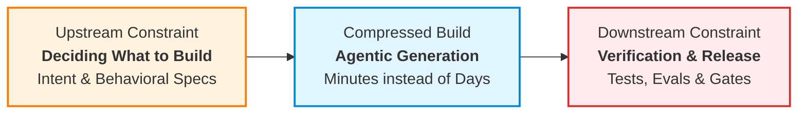
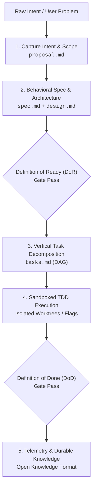
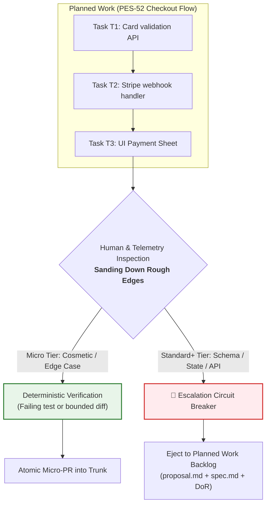
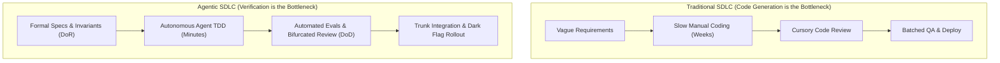

For decades, writing code was the slowest part of building software.

Requirements gathering, architectural reviews, QA cycles, and sprint planning were all built around a simple constraint: turning an idea into working syntax took days, weeks, or months of manual typing.

AI coding agents changed that almost overnight.

What used to take an engineer several days of focused typing can now be generated, wired up, and covered with unit tests in fifteen minutes.

At first, it feels like pure leverage. But as Eliyahu Goldratt demonstrated in *The Goal*, if you multiply the speed of one step in a pipeline without changing how work enters or leaves it, you do not speed up the system. You just pile up inventory in front of the next bottleneck.

Today, that inventory is unreviewed code. AI agents generate pull requests faster than teams can decide what they want, and far faster than humans can review, verify, and safely deploy the output.

To ship reliably with agents, teams have to rethink how work moves through their pipeline—and draw a clear line between **planned work** and **unplanned work**.

---

## The Shifting Bottleneck of the AI SDLC

When the build phase collapses to minutes, the constraints move out to the edges:



1. **The Upstream Constraint: Deciding What to Build**  
   If you feed an agent a loose prompt or a vague ticket, it won't push back or ask clarifying questions. It fills the gaps with plausible assumptions and generates hundreds of lines of working code that implements the wrong thing. The upstream bottleneck is defining clear intent and testable behavioral specifications before prompting an agent.

2. **The Downstream Constraint: Verification and Release**  
   Review queues are flooded with massive pull requests generated in seconds. If reviewers rubber-stamp them, regressions slip through. If they painstakingly read every token, team velocity grinds to a halt. The downstream bottleneck is automated verification, behavioral evaluations, and deterministic release gates.

Modern engineering frameworks—including the [Aliveness Product Engineering System](https://github.com/aliveness-dev)—address these bottlenecks with six practical disciplines:

- **Capture Intent**: Pin down the actual user problem and target outcomes before touching code.
- **Specify Behavior with Standards**: Use structured formats like OpenSpec with Given/When/Then scenarios.
- **Anchor Agents with Context**: Ground models in shared domain concepts, golden libraries, and system invariants.
- **Verify Continuously with Tests and Evals**: Rely on strict Test-Driven Development (TDD) and multi-turn behavioral evaluations.
- **Decouple Reviews with Enforced Gates**: Separate spec review from code review, guarded by Definition of Ready (DoR) and Definition of Done (DoD).
- **Feed Production Learnings Back into Knowledge**: Turn operational findings and post-mortems into durable documentation.

Within this workflow, you need a clear separation between what gets planned and what gets handled on the fly.

---

## Planned Work in Agentic Development

Planned work is deliberate capability expansion. In an agentic workflow, planned work is never defined as "writing code." **Planned work is the disciplined translation of intent into verified software.**



Here is how planned work operates when agents handle implementation:

### 1. No Clear Spec Means No Code
In traditional setups, teams often handed engineers vague tickets and expected them to figure out the details as they went. Doing that with an AI agent just generates plausible technical debt.

When a specification is missing or ambiguous, writing code is the wrong step. The work is an upstream planning problem:
- Capture the problem, user personas, constraints, and explicit non-goals (`proposal.md`).
- Turn business expectations into observable behavioral contracts using standards like [OpenSpec](https://openspec.dev/) with formal RFC 2119 keywords (`SHALL`, `MUST`, `MAY`).

If you cannot define how to verify a feature deterministically, an agent should not be writing code for it.

### 2. Acceptance Criteria as Executable Contracts
Acceptance criteria are not casual bullet points in a tracker. They are formal, scenario-driven contracts:

```markdown
### Requirement: Idempotent Payment Settlement
The billing engine SHALL settle authorization holds idempotently within a 72-hour window.

#### Scenario: Duplicate webhook receipt
- GIVEN an authorized transaction hold with ID `tx_123`
- WHEN the settlement webhook is received multiple times with identical payload
- THEN the system SHALL execute the ledger entry exactly once
- AND return HTTP 200 with the original settlement timestamp
- AND emit an idempotent duplicate warning metric to telemetry
```

Because these scenarios follow a strict Given/When/Then format, the agent can convert them directly into red-green test suites during the build step. The criteria become the guardrails that prevent the agent from wandering off into unrequested refactoring.

### 3. Clear Gates: Definition of Ready and Done
Quality gates protect both sides of the build process:

- **Definition of Ready (DoR)**: Protects the build step. Before an agent provisions an isolated Git worktree or touches a test, the proposal, behavioral scenarios, and technical design (`design.md`) must pass review.
- **Definition of Done (DoD)**: Protects the main trunk. A task is not complete when an agent reports that it finished. It is done when:
  1. All unit, integration, and contract tests pass with 100% scenario coverage.
  2. Linters, formatters, and static checks pass clean.
  3. The change is isolated behind a dark feature flag (`default: false`).
  4. Architectural choices are recorded in a Decision Record.

### 4. Progressive Rigor for Planned Capabilities
Not every planned feature requires the same administrative footprint. Scale documentation ceremony to the blast radius using **Progressive Rigor**:

| Tier | Trigger | Required Artifacts | Review Process |
| :--- | :--- | :--- | :--- |
| **Standard Tier (`tier: standard`)** | New API endpoint, database schema change, or state machine modification | `proposal.md`, `spec.md`, `design.md`, `tasks.md` | Bifurcated review: Approve spec first, then review code diffs |
| **Major Tier (`tier: major`)** | Multi-system refactor, billing architecture overhaul, cross-repo contract | Full PRD, research evidence, domain model, DRs, sliced DAG | Formal architecture review and multi-agent execution |

If a planned change alters public contracts, mutates state machines, or adds new infrastructure, it belongs in the Standard or Major tier. It requires clear intent, formal Given/When/Then scenarios, and a verified DoR before implementation begins.

### 5. Scope and Timeline Estimation
Traditional estimation techniques (story points, hours of typing) break down with agents. An agent takes roughly the same time to write fifty lines of simple logic as it does five hundred lines of boilerplate.

In an agentic workflow, estimation shifts to four practical factors:
- **Specification Ambiguity**: How many unknown interactions or edge cases remain unresolved?
- **Dependency Depth (DAG)**: How many sequential vertical slices (`tasks.md`) are required? Independent tasks run in parallel worktrees; sequential chains set the critical path.
- **Blast Radius**: How many existing contracts, shared schemas, or downstream services are touched?
- **Verification Latency**: How long does it take for CI suites, container sandboxes, and evaluations to prove correctness?

### 6. Durable Knowledge
Agents work in ephemeral context windows. Once a pull request merges and the session ends, the reasoning behind subtle decisions disappears.

Planned work is not complete until that context is recorded in durable documentation. Using structured formats like the Open Knowledge Format (OKF) in `docs/concepts/`, teams capture invariants discovered during implementation:

```markdown
---
id: "concept:ledger-idempotency-invariants"
title: "Ledger Settlement Idempotency & Webhook Invariants"
status: "verified"
confidence: 0.98
sources:
  - "specs/changes/2026-11-18-billing-settlement/spec.md"
---

# Ledger Settlement Invariants
All payment settlement operations must acquire a distributed Redis lock keyed on the idempotency token before mutating the double-entry balance ledger.
```

Persisting invariants in repository concepts gives future agent runs clear ground truth, preventing models from repeating the same architectural mistakes.

---

## Unplanned Work: Sanding Down Rough Edges

In traditional agile setups, "unplanned work" was often a catch-all bucket for production emergencies, sudden customer escalations, and mid-sprint scope creep.

In an agentic workflow, unplanned work has a much tighter, more practical role:

> **Unplanned work consists exclusively of small bug fixes, edge-case remediation, and post-build polish—sanding down the rough edges after a planned vertical slice is implemented.**



### The Reality of Sanding Down Edges
Here is what actually happens in day-to-day development:

You write a solid spec, hand a vertical slice task to an agent, and it builds the feature. The unit tests pass, the linter is happy, and the acceptance criteria are met. 

Then you pull the branch, run it locally, and start clicking around.

Almost immediately, you spot friction:
- An empty state shows blank space instead of a helpful prompt.
- An error message says `Error 422` instead of telling the user which field failed validation.
- A button tooltip clips off the edge on narrower screens.
- A currency input misbehaves when someone pastes a value with whitespace or a symbol.

This is not a failure of planning. Software is empirical. You cannot anticipate every nuance of a user experience in an abstract markdown document before seeing the real thing. 

This post-build polish is the natural, necessary home of unplanned work: **sanding down the rough edges**.

### Does Unplanned Work Need Specs?
When dealing with unplanned polish, teams usually swing between two bad extremes:
1. **Too Much Process**: Insisting that an engineer write a full `proposal.md`, `spec.md`, and task breakdown just to adjust button margins or add a null check. This slows work to a crawl, and developers will simply bypass the process.
2. **No Guardrails**: Giving an agent a loose prompt like *"make this form look better"* or *"clean up these edge cases."* Without boundaries, the model will hallucinate new UI libraries, rewrite CSS across multiple files, and introduce regressions.

The middle ground is simple: **Unplanned work does not need a new specification document. It needs a deterministic verification anchor.**

Depending on what you are polishing, that anchor takes one of two forms:

#### 1. Logic and Behavioral Edge Cases: The Test is the Spec
If the unplanned work addresses a bug, a missing edge case, or unexpected data handling, do not write a spec document. **Write a failing test.**
- Point the agent to the failing scenario.
- Have the agent write a minimal, red-green test reproducing the issue (for example, passing an empty array or an unformatted phone number).
- Once the test fails predictably, let the agent write the minimum production code needed to turn it green without touching surrounding logic.
- Optionally append the scenario to the parent feature's `spec.md` so the contract stays up to date.

#### 2. Cosmetic and Ergonomic Polish: Bounded Context & Diff Inspection
If the polish is visual or ergonomic (copy adjustments, spacing, empty states):
- Keep the agent's context strictly bounded to the target file or component (for example, on a quick `polish/checkout-empty-state` branch).
- Use a concrete, declarative instruction: *"In `PaymentSheet.tsx`, replace the blank container with `<EmptyState>` showing 'No payment methods found' and center the button."*
- Prohibit the agent from touching shared themes, installing new packages, or refactoring neighboring components.
- Inspect the resulting diff directly. If the diff touches files outside the boundary, reject it immediately.

### The Iron Rule: Unplanned Work is Exclusively Micro-Tier
This brings us to an essential operating rule: **If work is Standard Tier or above, it cannot be unplanned.**

In our tier model:
- **Micro Tier (`tier: micro`)**: Localized bug fixes, cosmetic polish, and edge-case tests on an active task. This is the **only** tier allowed to run as unplanned work.
- **Standard Tier (`tier: standard`)**: New database migrations, schema additions, new API endpoints, state machine transitions, or permission changes.
- **Major Tier (`tier: major`)**: Cross-service refactors, billing overhauls, and multi-system architecture contracts.

The moment an unplanned discovery requires a new database column, alters a state machine, or modifies a public API, **it is no longer "sanding down an edge." It is an architectural change.**

### The Escalation Circuit Breaker
What happens when you start investigating a minor rounding issue and realize the underlying balance ledger lacks concurrency controls?

**Never let an agent patch architectural flaws through ad-hoc chat prompts.**

```
[Unplanned Work: Sanding Rough Edges]
                  │
                  ▼
   Does it touch any of these?
   ├── Database schemas or migrations
   ├── Existing Given/When/Then contracts
   ├── State machine transitions
   ├── Authentication & security rules
   └── External dependencies or services
                  │
          ┌───────┴───────┐
         YES              NO
          │               │
          ▼               ▼
  [🚨 Circuit Breaker]   [TDD Micro-Fix]
  Eject to Planned Work   Merge to Trunk
```

When an unplanned fix crosses into structural territory, the **circuit breaker** trips:
1. **Stop Implementation**: Do not keep prompting the agent in the active worktree.
2. **Move to the Backlog**: File the work as a new **Standard Tier** item in your planned backlog.
3. **Plan Before Coding**: Write the `proposal.md`, update or add the `spec.md`, design the migration in `design.md`, and pass the Definition of Ready gate before returning to code.

This boundary keeps day-to-day polish fast while protecting the codebase from the architectural drift that unchecked agent generation creates.

---

## Operating Principles for an Agentic Delivery Pipeline

Adapting to this model changes how teams review code, structure branches, and measure progress:



### 1. Verification is the Scarce Resource
Generating code is cheap. Verifying that code is secure, resilient, and correct is expensive. Treat test suites, contract checks, and evaluation harnesses as your primary engineering assets. Code can always be regenerated; verification harnesses provide lasting confidence.

### 2. Bifurcate the Review Seam
Do not review specifications and code diffs in the same pull request.
- **Seam 1: The Specification Review**: The team reviews and approves `proposal.md`, `spec.md`, and `design.md`. Once this clears, intent and architecture are set.
- **Seam 2: The Code Review**: The team reviews the agent's pull request strictly against the agreed-upon specification. Did the tests verify the Given/When/Then scenarios? Did the checks pass? If yes, merge.

Separating these reviews stops engineers from debating product requirements inside a 600-line git diff.

### 3. Keep Trunk Safe with Dark Feature Flags
Because agents complete tasks in small vertical slices, long-lived feature branches are unnecessary. Merge vertical slices directly to the main trunk behind dark feature flags (`flag:checkout_v2: false`). This prevents merge conflicts, runs continuous integration across the whole codebase, and separates deployment from customer release.

### 4. Human Accountability Over Agent Autonomy
Agents are great execution partners inside sandboxes, but they cannot own outcomes.

Maintain a clear division of responsibility:
- **Agents** draft specifications, write tests, generate code, and diagnose errors.
- **Humans** review gates, authorize releases, and remain accountable for production.

---

## The Cultural Shift

Adopting an agentic SDLC is ultimately a workflow and cultural shift, not a tooling upgrade.

Engineering culture spent decades valuing the developer who could hammer out thousands of lines of code without a spec. Performance was measured by sheer volume: commits pushed, lines added, PRs merged.

In an agentic team, that dynamic flips:
- Generating hundreds of lines of un-specced code creates review bottlenecks and hidden regressions.
- The high-leverage engineer is the one who writes clear behavioral specifications, builds tight test harnesses, and captures system invariants so agents can execute safely.

When writing syntax is no longer the bottleneck, the real constraints become visible: unclear product direction, unspoken architectural assumptions, and slow review cycles. The teams that thrive with AI will not be the ones with the cleverest prompts—they will be the teams that build clear constraints, treat specifications as code, and master the balance between planned intent and post-build polish.
