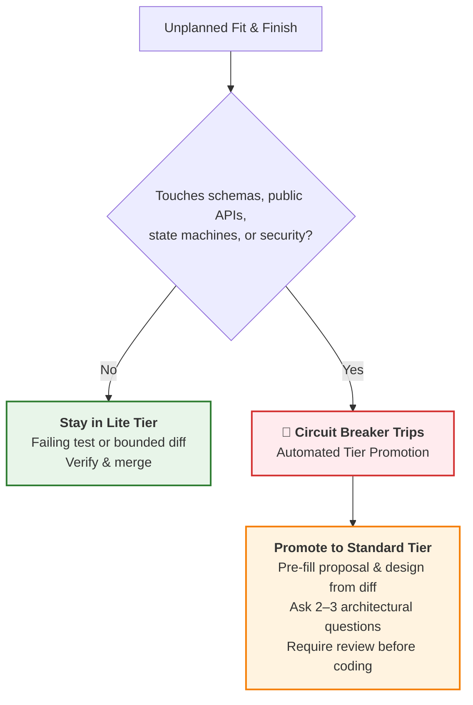

When writing code becomes nearly free, the economic foundation of software engineering flips.

For decades, writing syntax was the slowest, most expensive part of building software. Sprint planning, estimation poker, and change advisory boards all existed because turning an idea into working code took weeks of typing. Because typing was slow, unplanned work was the enemy—a surprise bug or sudden requirement shift derailed entire roadmaps.

AI coding agents changed that almost overnight. What used to take three days of focused implementation can now be scaffolded, wired up, and tested in minutes.

When code is this cheap to produce, teams tend to fall into one of two traps:

1. **The Bureaucracy Trap**: Forcing developers to write multi-page PRDs, technical designs, and tickets for every minor polish item. Developers quickly route around the process.
2. **The Prompt-and-Pray Trap**: Abandoning planning entirely under the illusion that "the agent can just fix it in chat." Without behavioral contracts, agents hallucinate assumptions, mutate database schemas, and generate unmaintainable sprawl.

As Eliyahu Goldratt demonstrated in _The Goal_: **if you 100x the throughput of one stage in a pipeline without restructuring the rest, you don't speed up the system. You just pile up inventory in front of the next bottleneck.**

Today, that inventory is unreviewed, unverified code—and the real bottlenecks have shifted upstream (deciding what to build) and downstream (verifying what was built).

---

## What Actually Counts as Unplanned Work

If an agent can implement a feature in minutes, what still counts as **unplanned work**?

> **In an agentic workflow, unplanned work is exclusively localized edge cases, bug fixes, and post-build fit-and-finish polish discovered after testing a working slice.**

You specify a feature, the agent builds it in a clean git worktree, and all unit tests pass. Then you launch the branch locally and start clicking around.

Reality immediately surfaces ergonomic friction that no upfront spec could foresee:

- An empty state shows blank space instead of a helpful call-to-action.
- An error notification displays `Error: 422` instead of explaining which field failed.
- A button tooltip clips off-screen on mobile viewports.
- An input parser chokes when users paste strings containing non-breaking spaces.

This isn't a failure of planning; software is an empirical medium. Interacting with a live build reveals last-mile polish that is impossible to predict in markdown.

Handling it shouldn't create process friction:

- **On an in-flight feature branch**: Fix it on the same branch. Write a reproducing test or verify the bounded UI diff directly—for a single-file fix, a red-green test is the most precise specification possible.
- **On code already in trunk**: Spin up a lightweight, isolated change with a short spec and task list, verify it in a sandbox, and merge a clean PR.

---

## One Entry Point, Progressive Rigor

The mistake most teams make is asking engineers to pick a process before they start working. In an agentic workflow, **the developer experience never changes**: you state your intent—the problem and desired outcome.

From that single prompt, the system inspects the codebase, assesses the blast radius, and automatically scales the documentation and review rigor to match the risk:

| Attribute                 | Lite Tier                                                                                             | Standard Tier                                       | Major Tier                                             |
| :------------------------ | :---------------------------------------------------------------------------------------------------- | :-------------------------------------------------- | :----------------------------------------------------- |
| **Typical Use**           | Fit & finish, edge cases, localized bug fixes                                                         | New endpoints, schema changes, state transitions    | Cross-repo contracts, billing or auth overhauls        |
| **Trigger**               | Live testing or targeted issue                                                                        | Roadmap feature or circuit-breaker escalation       | Strategic initiative                                   |
| **Artifacts**             | Consolidated `spec.md` (inline intent + 1–2 [OpenSpec](https://openspec.dev/) scenarios) & `tasks.md` | `proposal.md`, `spec.md`, `design.md`, `tasks.md`   | Full PRD, domain models, architecture decision records |
| **Before Coding**         | Quick check that scenarios & tasks are unambiguous                                                    | Peer review of spec & design before code generation | Multi-stakeholder review + feature flag strategy       |
| **Allowed as Unplanned?** | **Yes** (the only permitted unplanned tier)                                                           | **No**                                              | **No**                                                 |

For Standard and Major changes, separating spec review from code review is critical. Debating architecture inside an 800-line agent-generated diff is a recipe for review fatigue and regressions. For Lite changes, skipping heavy design docs keeps velocity high.

---

## The Low-Friction Circuit Breaker

The real danger in agentic development isn't fit-and-finish work—it's scope drift disguised as fit-and-finish.

You start out adjusting button padding, notice an edge case in checkout, and five minutes later the agent is rewriting database models and auth middleware inside an ad-hoc chat session.

**The Iron Rule:** Unplanned work can never exceed Lite Tier. If a change touches shared data schemas, public APIs, state machines, or security models, it cannot remain unplanned.



A circuit breaker only works if it feels like a guardrail, not bureaucratic punishment. In practice, tripping it should be almost frictionless:

1. **Passive Tripwires**: Tooling watches modified files. The moment a casual polish diff touches `prisma/schema.prisma`, `migrations/`, or route schemas, the system flags it immediately:
   ```text
   ⚠️ CIRCUIT BREAKER: Schema change detected in fit-and-finish polish.
   Auto-promoting change to Standard Tier...
   ```
2. **Pre-Populated Escalation**: Instead of handing the engineer a blank template, the system auto-generates `proposal.md` and `design.md` pre-filled from the reproduction context and dirty diff.
3. **Targeted Architectural Questions**: The agent asks 2–3 concrete questions to nail down the data contract and rollback path before writing further code.
4. **Clean Worktree Splitting**: Because agent builds run in ephemeral git worktrees, the safe cosmetic polish stays on the original branch to merge right away, while the architectural fix is parked in its own worktree awaiting review.

---

## The Cultural Shift

In traditional software development, leverage was tied to typing volume. When code is free, typing volume is a commodity. High leverage belongs to the engineer who formulates sharp intent, lets progressive rigor absorb the ceremony, and uses automated circuit breakers to protect architecture without slowing down.
