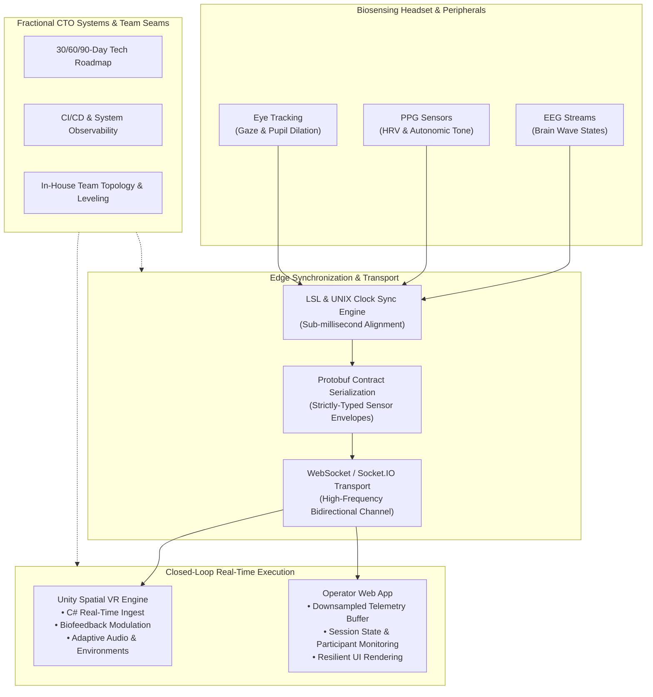
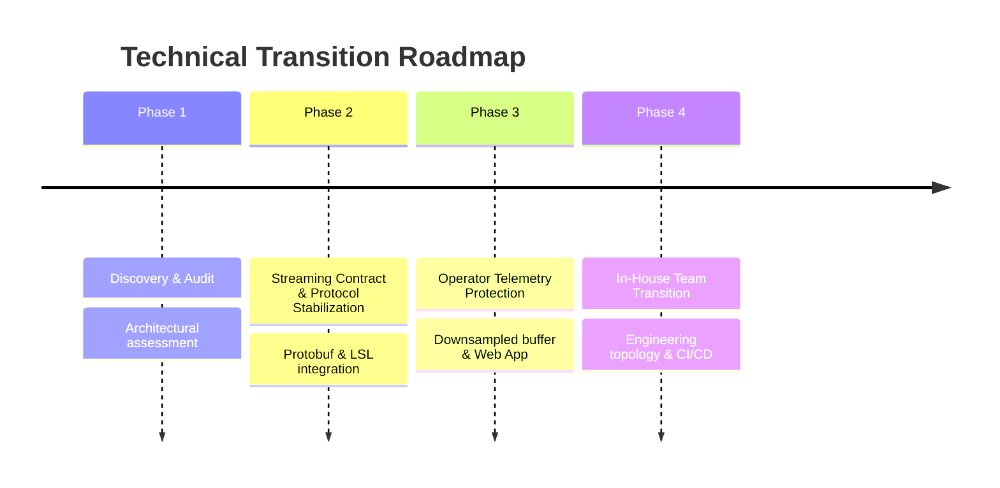

## Multimodal closed-loop biosensing and spatial computing

**Evolve** is a growth-stage deep-tech startup building an advanced human performance platform. By pairing hardware biosensors with real-time virtual reality (VR), it creates adaptive biofeedback training environments for high-stakes enterprise and performance training pilots.

As **Fractional CTO** and systems software advisor, I guided the founders and engineering team through critical architectural decisions, transforming complex hardware integration into a resilient, scalable software platform ready for investor readiness and enterprise deployments.

---

## Challenge

Integrating multimodal biosensing headsets (EEG, PPG, eye tracking) with immersive Unity VR requires extreme precision.

The core challenge was establishing a real-time, sub-millisecond synchronized data pipeline that could ingest high-frequency telemetry, align UNIX epoch clocks, and drive dynamic biofeedback without perceptible latency. Concurrently, the organization needed a clear technical roadmap and in-house team topology to transition from R&D into a reliable, enterprise-ready platform.

## Architecture & Approach

To achieve sub-millisecond alignment and robust transport, we established a closed-loop streaming pipeline centered on strict contracts and edge synchronization.

1. **Edge Synchronization**: Utilized Lab Streaming Layer (LSL) and UNIX clock sync engines to perfectly align EEG, PPG, and eye-tracking telemetry.
2. **Strict Contracts**: Implemented Protobuf serialization for strictly-typed sensor envelopes, eliminating ad-hoc parsing errors.
3. **Resilient Transport**: Leveraged WebSocket and Socket.IO for a high-frequency bidirectional channel.
4. **Adaptive Engine**: Ingested data streams directly into the Unity Spatial VR engine for real-time biofeedback modulation and adaptive audio-visual environments.
5. **Operator Visibility**: Downsampled telemetry into an operator web app for session state monitoring and resilient UI rendering.

## Fractional CTO Leadership

Transitioning from an R&D focus to product reliability required structured technical leadership and a predictable execution cadence. I established a phased transition roadmap, moving the architecture from diagnostic prototypes to stabilized enterprise platforms.

## Stack

The foundational layers combine hardware bridging, strictly-typed schemas, and spatial computing to power the real-time loop.

- **Edge Sync & Transport:** Lab Streaming Layer (LSL), Protobuf, WebSockets, Socket.IO
- **Simulation & UI:** Unity, C#, React, Web App
- **Methodology:** PRD-driven development, agile cadence, automated CI/CD

## Measurable Outcomes

- ✅ **Sub-millisecond** multimodal sensor synchronization and reliable UNIX epoch alignment.
- ✅ **Zero-downtime** pilot readiness across edge compute and immersive rendering.
- ✅ **Scalable team topology** implemented, moving from ad-hoc R&D to disciplined engineering delivery.
- ✅ **Clear transition roadmap** established for continued platform scaling and organizational growth.
