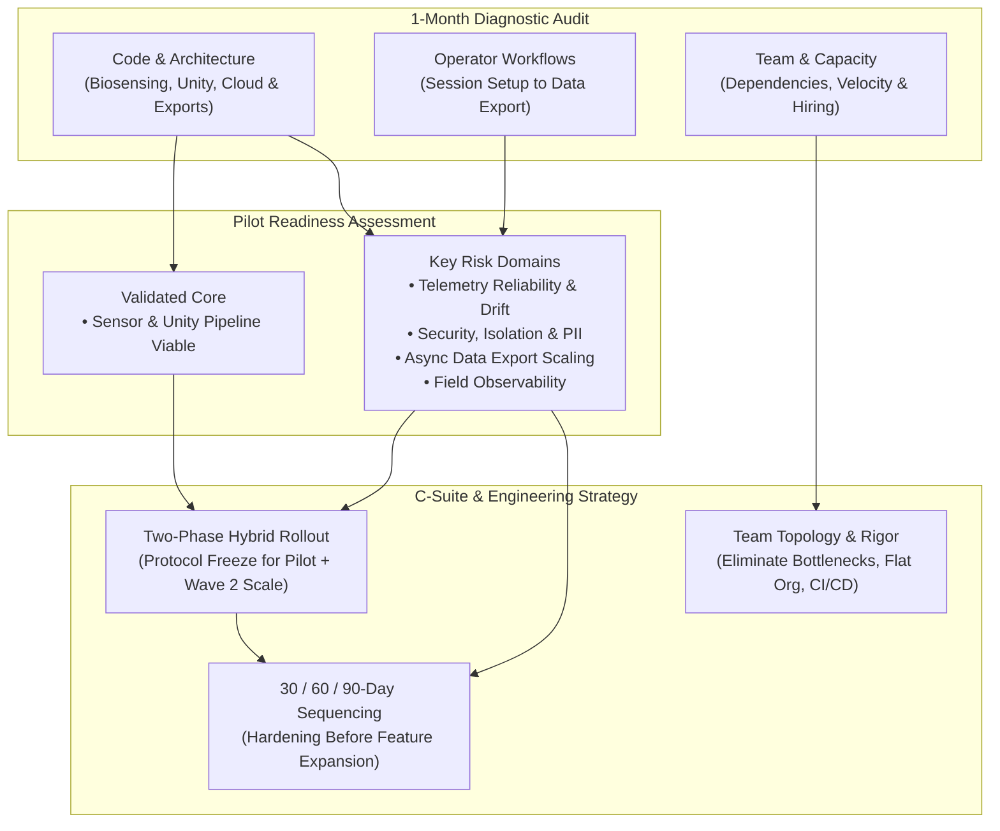
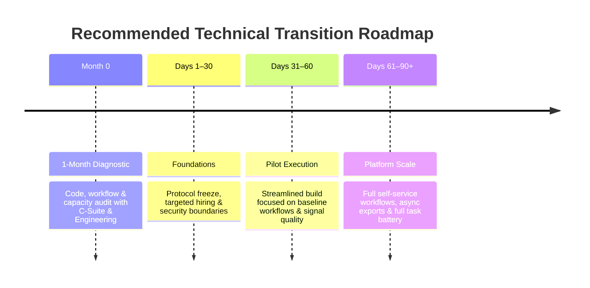

## Multimodal closed-loop biosensing and spatial computing

**Evolve** is a deep-tech human performance startup uniting multimodal hardware biosensors (EEG, PPG, eye tracking) with real-time Unity virtual reality (VR) to deliver adaptive biofeedback training environments for enterprise and research pilots.

Over the course of a month, I performed a **Platform Engineering & Pilot Readiness Diagnostic**, working directly with the **C-Suite** to bridge alignment gaps with **Engineering** and advise on technical strategy ahead of a high-stakes pilot launch.

---

## Challenge

Evolve's engineering team had proven the core biosensing and VR concept, but leadership lacked a ground-truth picture of whether the surrounding platform, operator workflows, and team capacity could support an upcoming pilot deadline.

The core challenge was translating complex, low-level systems risks into clear executive decisions: separating what was already working from what threatened pilot reliability, compliance, and delivery timelines—without derailing engineering momentum.

## Diagnostic Methodology

Rather than advising from slide decks, I embedded with both executive leadership and engineering over four weeks to audit the platform across three pillars:

1. **The Code & Architecture**: Audited biometric data acquisition, Unity real-time processing, cloud telemetry pipelines, security boundaries, and time-series data export paths.
2. **The Workflow**: Mapped the end-to-end operator and participant journey from session onboarding and device setup through live monitoring and post-session export.
3. **Team & Capacity**: Evaluated engineering bandwidth, key-person dependencies, delivery velocity, and hiring gaps against the pilot schedule.

## Strategic Recommendations

The diagnostic confirmed that Evolve's technical core was solid while surfacing four high-priority areas requiring hardening before commercial pilots: **Reliability**, **Security & Privacy**, **Data Export Scalability**, and **Observability**.

Working directly with the C-Suite, I translated these findings into an actionable technical strategy:

- **Two-Phase Hybrid Rollout**: Recommended freezing protocol scope for a streamlined, essential-only pilot build to protect the launch window, deferring full self-service expansion to a subsequent release.
- **Hardened Data Integrity & Export Architecture**: Advised adding telemetry sequencing, bounded queues, and retry/backpressure handling to prevent silent data drift, alongside moving heavy time-series CSV exports to asynchronous background workers to prevent backend memory exhaustion.
- **Security & Privacy by Design**: Recommended strict tenant isolation, authenticated ingest gateways, and stripping participant PII in favor of anonymized identifiers to streamline research and enterprise compliance.
- **Team Topology & Engineering Rigor**: Advised eliminating single-point-of-failure bottlenecks through targeted full-stack hiring and clear stack ownership, keeping the engineering organization flat to preserve velocity, and shifting from ad-hoc speed to CI/CD, automated testing, and structured observability.

## Areas Assessed

- **Biosensing & Simulation:** Multimodal sensor streams (EEG, PPG, eye tracking), Unity, C#, real-time signal processing
- **Cloud & Data Pipelines:** WebSocket telemetry ingest, time-series storage, asynchronous export queues, operator web applications
- **Engineering Organization:** Delivery forecasting, team topology, CI/CD & automated testing, structured observability

## Outcomes

- ✅ **C-Suite & Engineering Alignment:** Bridged executive leadership and engineering with a shared, evidence-backed view of technical risk, schedule reality, and business impact.
- ✅ **Prioritized Risk Register:** Delivered a concrete technical assessment across reliability, security/privacy, data export scalability, and field observability.
- ✅ **De-Risked Pilot Strategy:** Equipped leadership with a two-phase hybrid rollout and protocol-freeze framework to protect the pilot deadline without compromising commercial-grade foundations.
- ✅ **Actionable 30/60/90-Day Roadmap:** Defined the sequencing, hiring profile, and team structure needed to transition from R&D velocity to disciplined engineering rigor.
